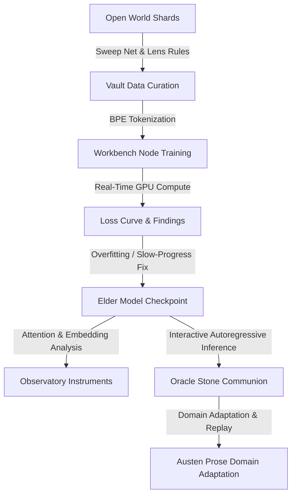

# NeuroArena Gameplay Integration Guide

## 1. The Core Diegetic Progression Loop

NeuroArena bridges open-world spatial exploration with real deep learning mechanics. The entire player progression directly reflects modern LLM training pipelines:

---

## 2. Stage-by-Stage Gameplay Systems

### Stage 1: Shard Harvesting & Lens Filtration
- **The World**: 1,900 textual shards scattered across 5 distinct regions (Meadow of Verse, Weathered Archive, Echo Hollow, Billboard Flats, Foreign Shore).
- **The Lens**: Real-time signal analysis (dictionary hit rate, repetition score, surprise score, uppercase ratio).
- **Sweep Net**: Players configure programmatic rules (e.g., Clean English Lens Rule) to harvest matching shards in an 18m radius while avoiding contaminated web boilerplate or OCR corruption.

### Stage 2: Vault Curation & Token Banking
- Shards deposit into the `VaultManager`, providing corpus tokens for training.
- Clean token thresholds (100k, 400k, 1.2M) unlock model architectures from Scout ($L=4$) up to Elder ($L=6$).

### Stage 3: Node-Based Workbench Training
- Players wire together computational graphs: Tokenizer $\to$ Embedding Matrix $\to$ Transformer Blocks $\to$ Causal Mask $\to$ Cross-Entropy Loss.
- Training executes in a Web Worker via pure WebGPU compute shaders, maintaining steady 60 FPS in the game viewport.

### Stage 4: Diagnostic Findings & Companion Guidance
- **Slow-Progress Detector**: Warns when learning rate is suboptimal ($\text{LR} \le 10^{-4}$), providing numeric evidence of sluggish loss reduction.
- **Overfitting Detector**: Fires when smoothed validation loss rises $\ge 0.05$ from minimum and train-val gap exceeds $1.0$, prompting the player to regularize or harvest more diverse text.

### Stage 5: The Observatory
- **Attention Instrument**: Visualizes QK dot-product attention weights, induction heads, and Shannon entropy distributions across layers.
- **Embedding Explorer**: 3D PCA projection of learned token vectors with top-$K$ nearest neighbor clustering and cosine similarity metrics.

### Stage 6: The Oracle Stone & Timeline Branching
- Diegetic stone monoliths in the wild and Dusk Camp.
- Players scribe prompts; the model continues autoregressively using GPU KV-caching.
- Players can inspect token entropy gauges, explore alternative continuation branches in a timeline tree, or adapt models to new literary domains (such as Jane Austen's Pride and Prejudice) with replay regularization to prevent catastrophic forgetting.
