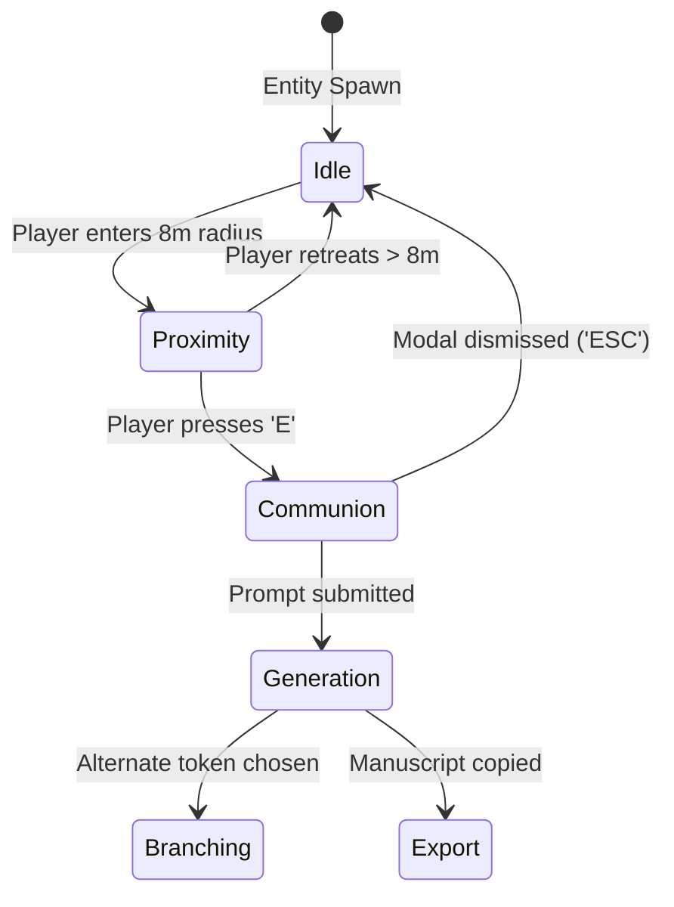

# Oracle Stone Communion Architecture & Lifecycle Specification

## 1. System Overview

The **Oracle Stone** is an interactive world entity in NeuroArena present both in the Camp hub and across the procedural biome landscapes. It serves as the physical and thematic bridge between the game world and the underlying autoregressive neural language model (the Elder or Scout checkpoint).

When players approach and commune with the Oracle Stone, the game initiates an in-context generative dialogue session powered by real-time WebGPU inference.

---

## 2. Interaction Lifecycle & State Progression

### Phase 1: Spatial Proximity & Visual Awakening
- When the player character approaches within an 8-meter radius of an Oracle Stone, the entity begins smooth linear interpolation of its visual and audio intensity.
- **Runic Accents**: The inner and outer concentric glyph rings accelerate their dual-axis counter-rotation from $\omega_{\text{idle}} = 0.5 \text{ rad/s}$ to $\omega_{\text{active}} = 2.0 \text{ rad/s}$.
- **Glow Intensity**: The point light pulses with an emissive sine wave:
  $$I(t) = I_{\text{base}} \cdot \left(1 + 0.35 \sin(3.5 t)\right) \cdot \text{clamp}\left(1 - \frac{d}{8}, 0, 1\right)$$
- **Auditory Drone**: An ambient procedural 55 Hz sub-bass hum (`playOracleHum`) is periodically modulated based on inverse square distance.

### Phase 2: Communion Initiation
- Upon pressing the interaction key (`E` by default), `handleInteraction` in `apps/game/src/main.ts` triggers `toggleOracle()`.
- **Acoustic Chime**: A pentatonic celestial bell chord (`playOracleCommune`: F4, C5, Eb5, G5) synthesizes via polyphonic bandpass-filtered oscillators with an exponential decay envelope ($T_{60} \approx 2.4 \text{ s}$).
- **Telemetry Event**: A telemetry packet (`recordOracleCommune`) logs the stone ID, position, and active model state.

### Phase 3: Generative Manuscript Interface
The `OracleModal` component mounts over the viewport with strict theme token styling (`var(--na-...)`):
- **Manuscript Scroll**: An editable textarea where the player scribes their initial prompt.
- **Hyperparameter Controls**: Sliders for Sampling Temperature ($T \in [0.1, 2.0]$), Top-K filtering ($K \in [1, 50]$), Nucleus Top-P ($P \in [0.1, 1.0]$), and Random Seed.
- **Autoregressive Streaming**: Tokens stream token-by-token from the WebGPU KV-cache engine.
- **Candidate Probability Inspector**: For any generated token, hover/click inspects the top 5 predicted candidates with relative probability bars and Shannon entropy gauges:
  $$H(X) = -\sum_{i=1}^V p_i \log_2 p_i$$
- **Branch Tree Management**: Clicking an alternate candidate forks generation into an independent branch node, maintaining a hierarchical tree of alternate textual paths.
- **Manuscript Export**: A one-click copy button exports the entire generated conversation transcript, complete with active branch history and token statistics, directly to the system clipboard.
