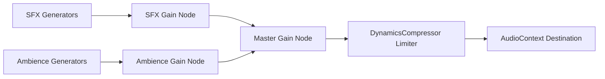

# Procedural Audio Engine & Spatial Attenuation Specification

## 1. Zero-Asset Audio Philosophy

The NeuroArena audio system (`packages/engine/src/audio.ts`) operates with **zero external audio asset files** (no `.mp3`, `.ogg`, or `.wav` network requests). Every sound effect, footsteps, ambient biome soundscape, and musical communion chime is synthesized dynamically at runtime using the **Web Audio API**.

This guarantees:
- Zero audio loading latency or missing audio HTTP 404 errors.
- Infinitely procedural variability without audible looping artifacts.
- Negligible binary bundle size footprint.

---

## 2. Master Graph Topology

All audio channels route through a dedicated master limiter to prevent clipping and distortion:

### Limiter Parameters:
- **Threshold**: $-1.0 \text{ dB}$
- **Knee**: $12.0 \text{ dB}$
- **Ratio**: $16.0 : 1$
- **Attack**: $0.003 \text{ s}$
- **Release**: $0.25 \text{ s}$

---

## 3. Biome Ambient Soundscapes

Ambience is generated using continuous procedural audio buffers shaped by modulated biquad filters:

1. **Meadow of Verse**:
   - Filtered brown noise simulating gentle prairie wind ($f_c \approx 450 \text{ Hz}$).
   - Periodic birdsong: frequency-modulated sine bursts ($2.4 \text{ kHz} \to 3.8 \text{ kHz}$) triggered by Poisson intervals.
2. **Shoreline**:
   - Low-frequency sine LFO ($T \approx 7.5 \text{ s}$) modulating noise gain to recreate the rhythmic surge and foam of ocean surf.
3. **Ridge / Billboard**:
   - High-resonance bandpass filter ($Q \approx 4.0$) sweeping between $800 \text{ Hz}$ and $1800 \text{ Hz}$ to synthesize whistling high-altitude mountain wind.
4. **Archive / Cavern**:
   - Sub-bass rumble ($45 \text{ Hz}$) paired with soft harmonic overtone shimmer.

---

## 4. Celestial Harmonic Synthesis (Oracle Stone)

Interactions with the Oracle Stone employ integer-ratio harmonic series based on philosophical tuning ($A = 432 \text{ Hz}$):

### 4.1 Communion Chime (`playOracleCommune`)
Synthesizes a 4-part polyphonic overtone chord:
- $f_1 = 216 \text{ Hz}$ (Sub-harmonic octave)
- $f_2 = 324 \text{ Hz}$ (Perfect fifth)
- $f_3 = 432 \text{ Hz}$ (Fundamental)
- $f_4 = 648 \text{ Hz}$ (Octave fifth)

Each partial features an upward micro-pitch bend ($+0.8\%$) and exponential decay envelope ($T_{60} \approx 2.2 \text{ s}$).

### 4.2 Branch Fork Shimmer (`playOracleBranchFork`)
When branching an alternate token trajectory, a crystalline dual-frequency burst excites at $864 \text{ Hz}$ and $1296 \text{ Hz}$ with a fast 450 ms decay.

### 4.3 Proximity Resonance Drone (`playOracleHum`)
A filtered triangle oscillator at $108 \text{ Hz}$ passed through a 240 Hz lowpass filter, gently pulsing when the player stands near the monolith.

---

## 5. 3D Spatial Attenuation

Spatial sound emitters attenuate gain based on listener-emitter Euclidean distance:

$$G(d) = \begin{cases} 1.0 & \text{if } d \le d_{\text{min}} \\ \left(1 - \frac{d - d_{\text{min}}}{d_{\text{max}} - d_{\text{min}}}\right)^\gamma & \text{if } d_{\text{min}} < d < d_{\text{max}} \\ 0.0 & \text{if } d \ge d_{\text{max}} \end{cases}$$

Default parameters:
- Minimum near radius $d_{\text{min}} = 1.5 \text{ m}$
- Maximum cutoff radius $d_{\text{max}} = 35.0 \text{ m}$
- Rolloff exponent $\gamma = 1.8$
