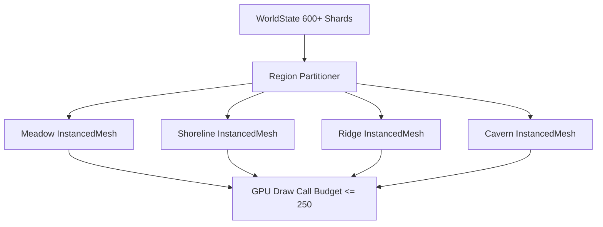

# Shard Instancing, Spatial Indexing & Sweep Net Specification

## 1. Architectural Overview

The knowledge shards distributed across NeuroArena's landscape represent individual corpus data samples. To render hundreds of interactive, animated shards simultaneously across expansive terrains within strict web draw call and frame time budgets (Low: 120 calls, Medium: 250 calls, High: 500 calls), `ShardWorld` implements a **GPU Instanced Mesh Architecture** coupled with **Uniform 2D Spatial Hash Grid Indexing**.

---

## 2. GPU Instanced Mesh Batching

Instead of allocating individual `THREE.Mesh` instances per shard:
- Shards are partitioned by biome region (`meadow_of_verse`, `shoreline`, `ridge`, `cavern`).
- Each region maintains exactly two `THREE.InstancedMesh` draw batches:
  1. **Shard Cluster Geometry**: Procedural polyhedral crystal mesh.
  2. **Glyph Cluster Geometry**: Textured billboard displaying floating subword token phrases.
- Total draw calls for the entire shard ecosystem scale as $O(\text{regions})$ rather than $O(\text{shards})$.

---

## 3. Spatial Hash Grid Indexing

Candidate interaction and scan queries avoid $O(N)$ linear scans through a 2D spatial hash grid:

- **Cell Bucketing**: The world horizontal plane $(x, z)$ is discretized into buckets of cell size $S_{\text{cell}} = 32.0 \text{ m}$.
- **Radius Queries (`queryRadius`)**: Given player position $(p_x, p_z)$ and query radius $R$, only cells overlapping the bounding square $[p_x - R, p_x + R] \times [p_z - R, p_z + R]$ are examined.
- **Fast-Path Squared Distance**: Intra-cell candidate filtering computes $d^2 = \Delta x^2 + \Delta z^2$ and compares directly against $R^2$, executing zero unnecessary `Math.sqrt` calls during traversal.

---

## 4. Multi-Tier LOD and Culling Boundaries

Per-frame animations (bobbing, rotation, OCR noise tremor, duplicate echoes) are gated across hierarchical distance radii:

| Boundary Radius | Functionality & Culling Rule |
| :--- | :--- |
| **$d \le 3.8 \text{ m}$** | **Interaction Envelope**: Hold `[E]` to harvest into player Vault. |
| **$d \le 28.0 \text{ m}$** | **Lens Scan Envelope**: Live signal evaluation (Perplexity, Repetition, Non-alpha, Dictionary hit rate). |
| **$d \le 35.0 \text{ m}$** | **Glyph Billboard Threshold**: Subword token glyphs rendered. Beyond 35m, glyph instances are scaled to zero. |
| **$65 \text{ m} < d \le 140 \text{ m}$** | **Mid-Field Shard Animation**: Polyhedral mesh bobbing and base ambient rotation. |
| **$140 \text{ m} < d \le 220 \text{ m}$** | **Far-Field LOD Attenuation**: Dynamic geometry scale factor attenuated smoothly ($1.0 \to 0.65$) to minimize rasterization load. |
| **$d > 220 \text{ m}$** | **Frustum / Distance Cull**: Shards zero-scaled and removed from transformation updates. |

---

## 5. Sweep Net Channeling Protocol

Players equipped with advanced Lens tiers can trigger the **Sweep Net** (`Q`):
- **Channel Radius**: $R_{\text{sweep}} = 18.0 \text{ m}$.
- **Channel Duration**: 1.2 seconds with expanding visual planar ring mesh.
- **Movement Invalidation**: If player position drifts $> 0.5 \text{ m}$ from activation coordinates, channel is cancelled immediately.
- **Batch Harvest**: On completion, all uncollected shards meeting the active Lens filtering rule are atomically added to the Vault.
