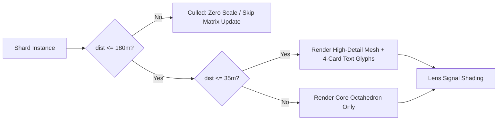

# Spatial Hashing, Frustum Culling & Instanced LOD Optimization

## 1. Spatial Hash Grid Mathematics

In an open world spanning $2\text{km} \times 2\text{km}$ containing thousands of dynamic entities, brute-force $O(N)$ proximity searches are unacceptable for real-time 60 FPS performance. NeuroArena implements an efficient 2D/3D `SpatialHashGrid` (`packages/game-core/src/spatial.ts`).

### Coordinate Mapping & Cell Key
Given world coordinates $(x, z)$ and a grid cell size $S = 32\text{m}$:
$$c_x = \lfloor x / S \rfloor, \quad c_z = \lfloor z / S \rfloor$$
$$\text{key} = c_x + \text{','} + c_z$$

### Radius Query Complexity
Radius search within radius $R$ scans only overlapping grid cells:
$$\Delta c = \lceil R / S \rceil$$
Number of probed cells is at most $(2\Delta c + 1)^2$. For $R = 18\text{m}$ and $S = 32\text{m}$, $\Delta c = 1$, scanning exactly 9 cells regardless of total world size, achieving optimal $O(1)$ amortized lookup.

---

## 2. Instanced Mesh Culling & LOD Pipeline

Rendering 1,900+ textual shards with individual draw calls would overwhelm the GPU command processor. Shards are clustered into per-region `THREE.InstancedMesh` buffers with multi-tiered distance culling:

### Multi-Tier Distance Hierarchy
1. **$d > 180\text{m}$ (Cull Radius)**:
   - Shard matrix scaled to zero and placed below ground ($y = -9999$).
   - Vertex shader performs zero work; rasterizer skips fragment processing entirely.
2. **$140\text{m} < d \le 180\text{m}$ (LOD Attenuation)**:
   - Gentle geometric scale reduction down to 65% size to reduce pixel fill-rate at horizon overlooks.
3. **$35\text{m} < d \le 140\text{m}$ (Core Geometry)**:
   - Renders low-poly base crystal without text rendering overhead.
4. **$d \le 35\text{m}$ (High Detail & Text Glyphs)**:
   - 4-card quad cluster with dynamic Canvas UV textures enabled. Text lines become legibly legible to the player.

---

## 3. Sweep Net Area-of-Effect Algorithm

The Sweep Net allows bulk harvesting of clean shards while automatically filtering contaminated or boilerplate text based on active Lens Rules:
- **Radius**: $R = 18.0\text{m}$.
- **Channel Duration**: $1.0\text{s}$ with visual expanding floor ring.
- **Interruption Guard**: Player movement $> 0.5\text{m}$ from the channel origin cancels the sweep, preventing unintended harvesting while running.
- **Lens Filtering**: Candidate shards within $18\text{m}$ are tested against the player's active Lens Rule; conforming shards are collected, while rejected shards remain intact.
