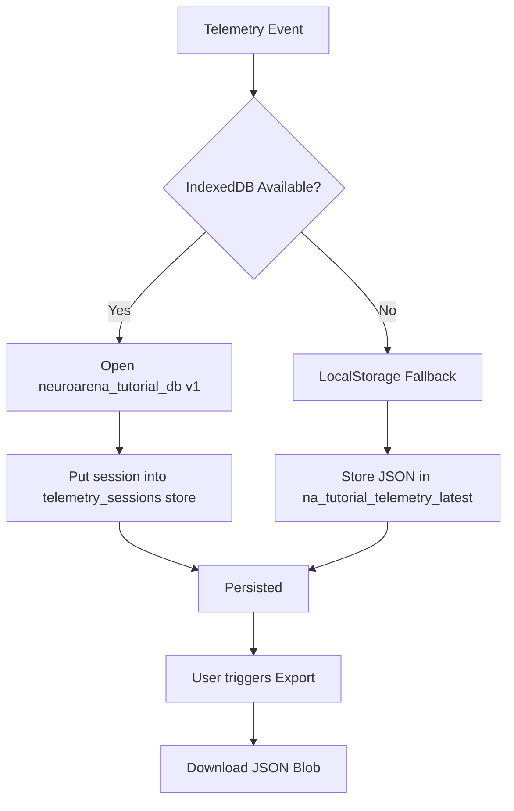

# Telemetry & Metrics Architecture Specification

## 1. Architectural Philosophy: Privacy-First & Local-Only
NeuroArena adheres strictly to a zero-remote-transmission policy for gameplay and training telemetry:
- **Zero Remote Outbound Requests**: No third-party tracking scripts, analytics beacons, or remote log endpoints exist in the codebase.
- **Client-Side Persistence**: All telemetry is stored locally inside the browser using IndexedDB (`neuroarena_tutorial_db`) with fallback to browser `localStorage` when IndexedDB is unavailable (e.g. private browsing or sandboxed iframes).
- **User Ownership**: Players and researchers retain complete control of their telemetry. A dedicated export mechanism downloads raw JSON telemetry archives directly to the user's filesystem (`neuroarena_tutorial_telemetry_<timestamp>.json`).

---

## 2. Telemetry Session Schema

The core session data structure is defined in `packages/game-core/src/tutorial/types.ts`:

```typescript
export interface StepTelemetryEntry {
  stepId: TutorialStepId;
  startedAt: number;
  completedAt?: number;
  durationSec: number;
  stalled: boolean;
  stallSeconds: number;
  attempts: number;
}

export interface TutorialTelemetrySession {
  sessionId: string;
  startedAt: number;
  completedAt?: number;
  totalDurationSec: number;
  completedSteps: StepTelemetryEntry[];
  stalledStepsCount: number;
  oracleCommunesCount?: number;
  oracleTokensGenerated?: number;
  oracleBranchesForked?: number;
  samplingAdjustmentsCount?: number;
  oracleTotalLatencyMs?: number;
  oracleMaxBranchDepth?: number;
  oracleAverageSurprise?: number;
  oracleSurpriseSamplesCount?: number;
  hardwareSummary?: string;
}
```

---

## 3. Step Progression & Stall Detection Protocol

The `TutorialTelemetry` class in `packages/game-core/src/tutorial/telemetry.ts` coordinates state transitions:
1. **Step Lifecycle**:
   - `recordStepStart(stepId)` initializes timing and increments the retry count if repeated.
   - `recordStepEnd(stepId, succeeded)` computes elapsed duration, pushes the finalized entry into `completedSteps`, and persists the session.
2. **Stall Detection**:
   - If player interaction stalls (e.g., loss fails to improve or user remains inactive during a diagnostic phase), `recordStall(stepId, stallSec)` marks the active step entry and updates `stalledStepsCount`.
3. **Session Completion**:
   - `recordSessionComplete()` computes total session duration in seconds and stamps the completion timestamp.

---

## 4. Oracle Communion & Autoregressive Inference Analytics

When the player interacts with an Oracle Stone (either in the open world or camp):
- **Token Generation**: Each generated token increments `oracleTokensGenerated`.
- **Inference Latency**: `recordOracleGenerationLatency(latencyMs, branchDepth, meanSurprise)` tracks cumulative generation time, dynamic tokens/second rates, and running average Shannon surprise ($-\log_2 P(w_t)$).
- **Timeline Branching**: `recordOracleBranchFork(depth)` logs tree forks and records maximum tree depth explored in the timeline visualizer.
- **Hyperparameter Adjustments**: `recordSamplingAdjustment()` tracks player tuning of temperature, nucleus $p$, top-$k$, or repetition penalty.

---

## 5. Storage Topology & Fallback



This ensures zero telemetry loss regardless of host environment constraints.
