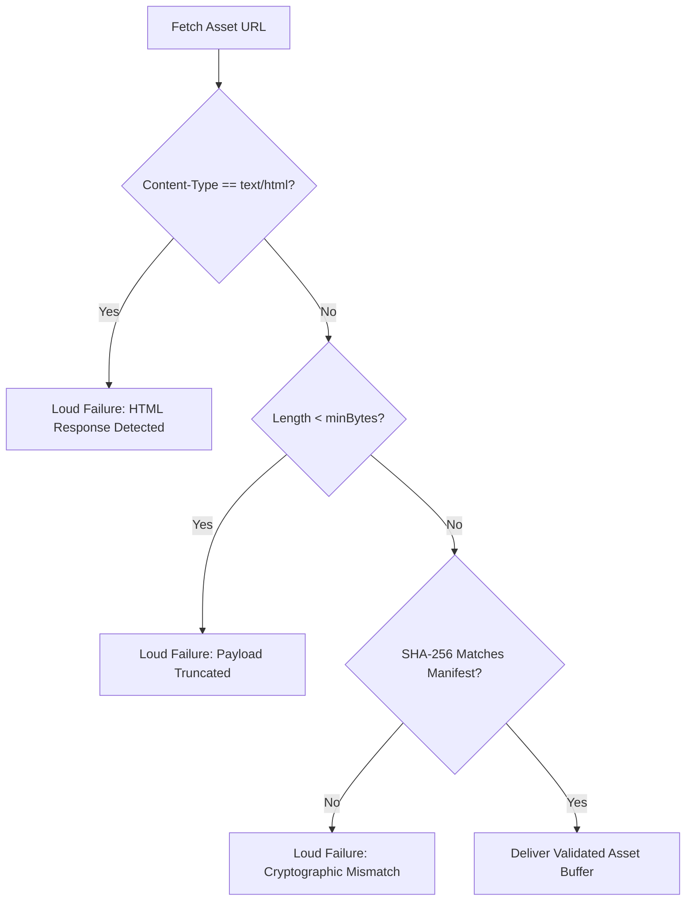

# Tamper-Proof Asset Manifest & Fetch Validation Specification

## 1. Threat Model & Root Cause Mitigation

In client-side single page applications (SPAs), a classic failure mode occurs when a request for a static data asset (e.g. `corpora/tutorial.txt` or `checkpoints/elder.json`) returns HTTP 200 with `text/html` containing the fallback `index.html`. 

If a neural network trainer ingests this response, it trains on HTML markup rather than actual corpus text, causing catastrophic loss regression (train loss plummeting while validation loss explodes beyond random baseline).

---

## 2. Hardened Asset Validation Architecture

NeuroArena routes all static asset fetches through a unified gateway: `fetchValidatedAsset` (`packages/ml-core/src/assetLoader.ts`).

### Strict Verification Gates
Every asset fetch must pass four sequential gates before being delivered to the engine or ML runtime:

1. **HTML Response Guard**:
   Checks `response.headers.get('content-type')`. Any response containing `text/html` is immediately rejected.
2. **Minimum Length Guard**:
   Enforces a strict minimum byte threshold (e.g., tokenizers $\ge 500$ bytes, corpora $\ge 1,000$ bytes, model checkpoints $\ge 10,000$ bytes).
3. **MIME Type Validation**:
   Verifies that JSON files declare `application/json` and binary buffers declare `application/octet-stream`.
4. **SHA-256 Cryptographic Checksum**:
   Computes the SHA-256 digest of the payload using the Web Crypto API (`crypto.subtle.digest('SHA-256', data)`) and compares against the build-time asset manifest (`assetManifest.ts`).

---

## 3. Server Configuration & SPA 404 Routing

In Vite development and production preview configurations:
- Requests for URLs containing file extensions (e.g., `*.json`, `*.bin`, `*.txt`) that do not exist on disk return explicit **HTTP 404 Not Found**, rather than serving `index.html`.
- The game UI detects asset loading failures and renders a diegetic Ancient Glyph Corrupted error screen instead of allowing silent training failure.
